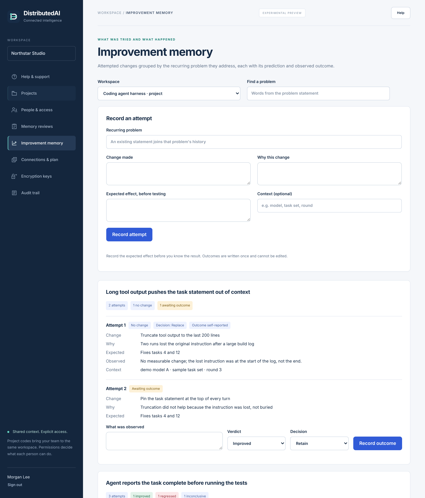

<!-- SPDX-License-Identifier: Apache-2.0 -->
# Improvement memory

Improvement memory is a shared record of what a team and its AI clients have tried in order to fix a recurring problem, and what happened each time. It answers three questions that a changed prompt, skill, tool rule or configuration cannot answer for itself: why was this change made, what was it expected to fix, and what did it actually do?

> **Experimental.** This feature stores and returns records. It does not evaluate a change, choose between candidates, call a model or act on a decision. Whether consulting the record improves any particular workflow has not been measured in this repository.

## Origin

The record structure follows *Self-Improvement Memory Enables Continual Recursive Self-Improvement* (Yu et al., Google, 13 November 2026, [arXiv:2611.18856](https://arxiv.org/abs/2611.18856)). That paper gives a harness optimiser a memory of its own edits: edits are grouped by the recurring problem they address, and each attempt keeps its rationale, the outcome predicted before evaluation, the outcome observed afterwards and the context it was tested in. The paper reports that carrying this history into further optimisation finished with higher scores than carrying the evolved harness alone, in the settings it tested.

DistributedAI adopts the record, not the optimiser:

| Paper | DistributedAI |
| --- | --- |
| Entry per recurring problem, holding ordered attempts | `improvement_record` groups attempts under one problem per scope |
| Each attempt stores the modification and its rationale | `change` and `rationale` are required |
| Predictions are recorded before evaluation and checked afterwards | `predicted` is required when the attempt is recorded; `improvement_outcome` adds `observed` later |
| Outcomes are kept even when an edit regresses or fails | An outcome is written once and never edited; verdicts include `regressed`, `no_change` and `inconclusive` |
| Provenance: domain, benchmark, policy model, round | Free-text `context`, plus the recording identity and time kept by the server |
| Entries with identical problem text are merged without dropping history | Statements that match after Unicode normalisation, case folding and whitespace collapsing join the same entry |
| Proposer and selector read the complete record | Any authorised MCP client reads it with `improvement_list`; a listing returns at most 50 problems |
| Retain, revise, replace or remove a modification | `decision` records one of those four words |

The paper's results come from automated harness optimisation with matched budgets and held-out evaluation. This service has no evaluator and no optimisation loop, so those results do not transfer to it as evidence. Treat the feature as a disciplined way to keep improvement history, on the assumption that a client or person who reads that history makes better-informed changes.

## Using it

A client with writer access records an attempt before testing it:

```json
{
  "scope_id": "<project scope id>",
  "problem": "Agent declares the task complete before running the tests",
  "change": "Add a completion gate that requires a passing test command",
  "rationale": "Three failed runs ended without any test command in the trace",
  "predicted": "Fixes tasks 3 and 7; no effect on the others",
  "context": "model-a / suite-1 / round 2"
}
```

The reply carries `problem_id`, `attempt_id`, the attempt `number`, and `problem_created` (false when the attempt joined an existing problem).

After the change has been tried, a writer records what happened:

```json
{
  "attempt_id": "<attempt id>",
  "observed": "Task 3 fixed. Task 7 still fails. Tasks 1 and 9 now time out.",
  "verdict": "regressed",
  "decision": "revise"
}
```

Before proposing a further change, any reader calls `improvement_list` with the scope and an optional `query`, which matches the problem statement. Each problem is returned with a count of attempts by verdict and the full attempt history in order.

### Operations

| Operation | Minimum role | Effect |
| --- | --- | --- |
| `improvement_record` | Writer | Adds an attempt, creating the problem entry if no matching statement exists in that scope |
| `improvement_outcome` | Writer on the attempt's scope | Records `observed`, `verdict` and `decision` once |
| `improvement_list` | Reader | Returns problems and attempts for the scope and the ancestors the caller can read |
| `improvement_delete` | Scope admin with delete permission | Permanently removes one problem and its attempts |

`verdict` is one of `improved`, `no_change`, `regressed`, `inconclusive`. `decision` is one of `retain`, `revise`, `replace`, `remove`.

The same four operations are available as MCP tools and through the management API. The console's **Improvement memory** screen lists problems, records attempts and records outcomes; deletion is available through the API and MCP only.



*Actual application screenshot · fictional demonstration data.*

## Rules the service enforces

- **Prediction first.** An attempt cannot be recorded without `predicted`, and the prediction cannot be changed afterwards. The server cannot prove that the caller had not already seen the result; it only fixes the order in which the two were written and records both times.
- **One outcome, never edited.** A second outcome for the same attempt is refused. To correct or follow up, record a further attempt under the same problem.
- **Failures stay.** There is no operation that edits or removes a single attempt. Deleting a whole problem requires scope-admin authority and the delete permission, and is audited.
- **Who recorded the outcome.** Each attempt shows `recorded_by` and `outcome_by`. `independent_outcome` is true when they differ. This is identity separation only; two identities are not proof of two independent evaluators, and a self-reported outcome is accepted and labelled.
- **Scope reach.** A listing covers the requested scope and those ancestors the caller can read. It never includes sibling or descendant scopes. Attempts are grouped only within one scope; the same statement in another scope is a separate entry.
- **Untrusted data.** Returned text carries `trust: untrusted_data`. A recorded decision is a statement by another identity, not an instruction to change anything.
- **Screening.** Problem, change, rationale, prediction, context and observation text passes the same deterministic screening as other payloads. Text with findings is refused and not stored, because this record has no review queue. Screening has false positives and false negatives.

## Limits

| Limit | Value |
| --- | --- |
| Problem statement | 500 characters |
| Change, rationale, prediction, observation | 4,000 characters each |
| Context | 500 characters |
| Problems per scope | 500 |
| Attempts per problem | 50 |
| Problems returned by one listing | 50 |

Reaching a limit returns `limit_exceeded`. Problems are not paginated; `list_truncated` reports when more than 500 problems were visible across the scope and its ancestors.

## Storage, encryption and lifecycle

- Problem statements, changes, rationales, predictions, context and observations are encrypted per tenant with the other protected payloads. Verdicts, decisions, attempt numbers, identities and timestamps are structural metadata and are stored in clear. See [encryption](ENCRYPTION.md).
- Grouping compares decrypted statements of one authorised scope in memory. No plaintext or hashed index of problem text is stored.
- When metering is enabled, the text counts towards the organisation's storage quota and is released when a problem or its scope is deleted.
- Memory export and encrypted scope and organisation archives include both tables. Whole-database backup includes them as it does every table.
- Deleting a scope with `delete_contents` removes its problems and attempts. Merging departments moves them to the target department; if both departments held the same problem statement, both entries remain and new attempts join the older one.
- New installations and existing databases gain the two tables at start-up. No existing table changes.

## Not included

- Automatic evaluation, scoring, candidate selection or any optimisation loop.
- Semantic matching of problem statements. Two differently worded descriptions of one problem are separate entries.
- Search within attempt text; `query` matches the problem statement only.
- Pagination, a console control for deletion, or editing and merging of problem entries.
- Evidence that using the record improves outcomes. The supporting results are the cited paper's, for a different system.

Automated tests cover grouping, single-outcome enforcement, roles, scope reach, tenant isolation, screening, limits, encryption at rest, export, archives, merge, deletion, quota accounting, MCP tool binding, the management API, and concurrent recording across two PostgreSQL clients. See [validation](VALIDATION.md).
